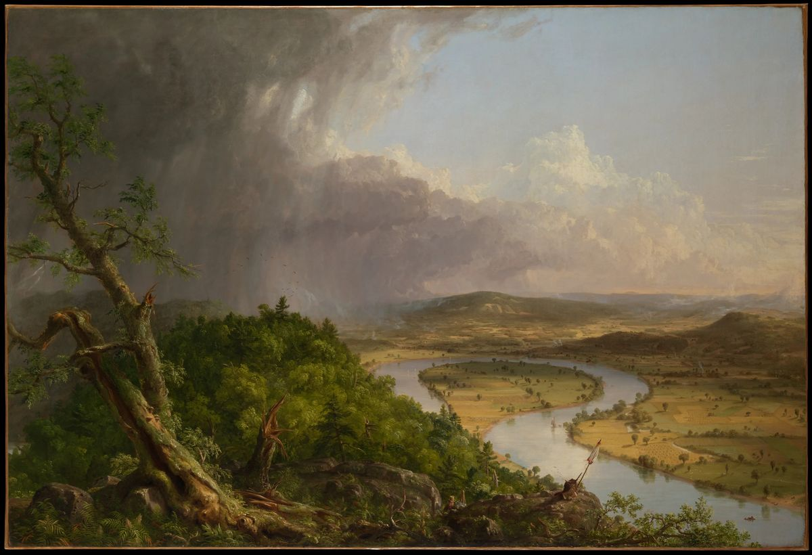
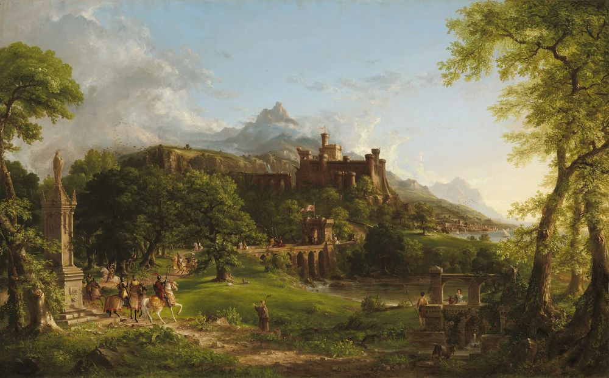
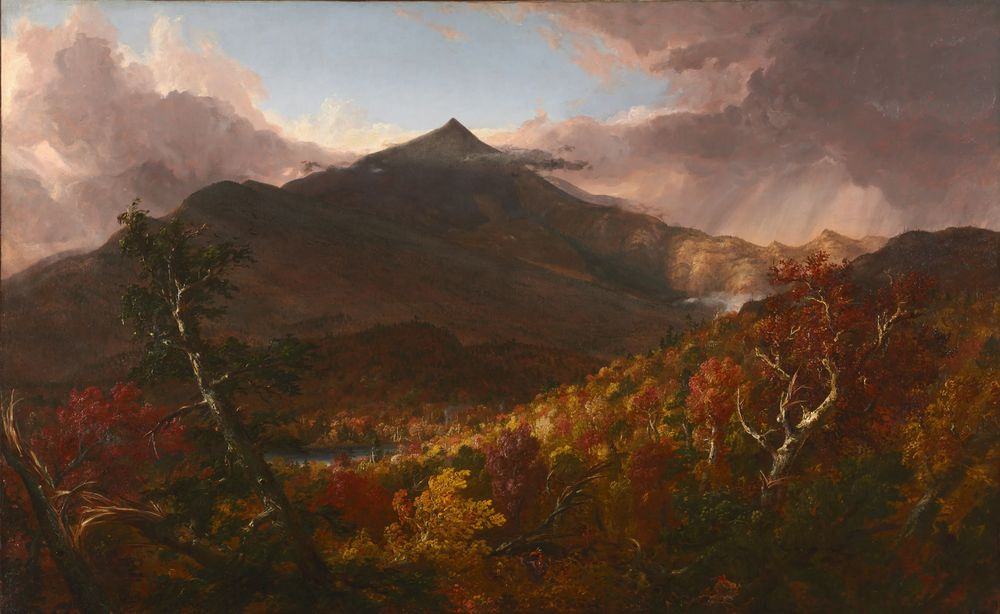
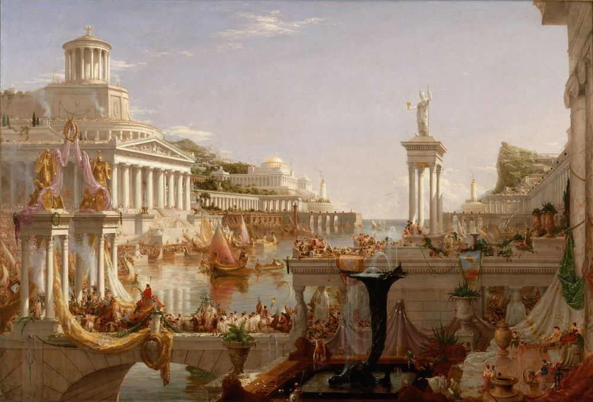
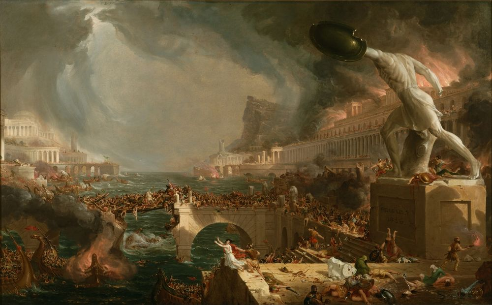
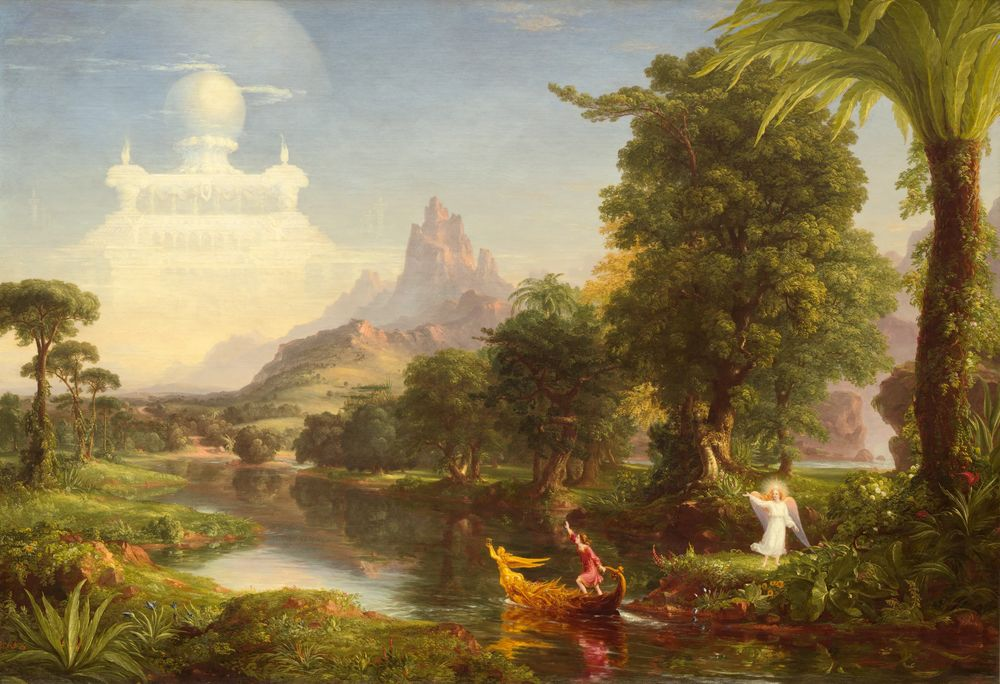
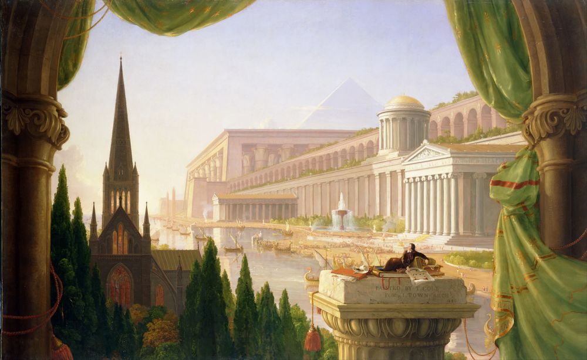
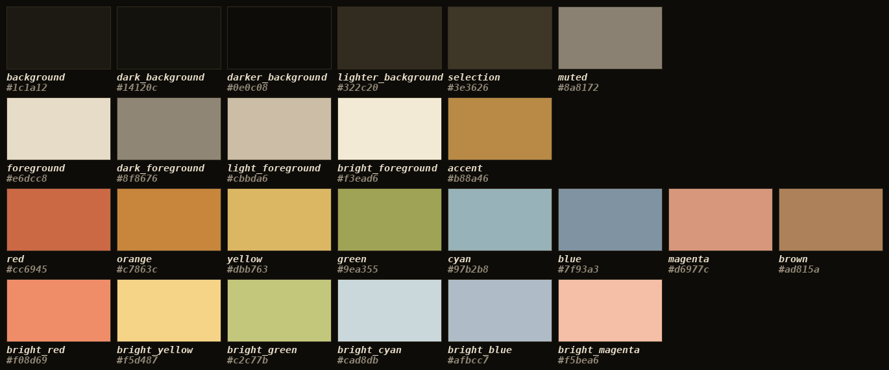

# Thomas Cole



A dark Omarchy theme drawn from the paintings of Thomas Cole, founder of the Hudson River School.

The palette is the paint itself: shadowed woodland for the background, sunlit cloud for the text, and hayfield gold for the accent. Wallpapers are museum scans of the paintings.

```bash
omarchy theme install thomas-cole
```

Until the theme is listed, install it from this repository:

```bash
omarchy theme install https://github.com/wynandt/omarchy-thomas-cole-theme
```

`omarchy theme bg next` cycles the paintings. Super+Ctrl+Space opens the background switcher.

## Preview

<!--
TODO(screenshot): replace this comment with a real full-desktop screenshot,
then save the same file as preview.png at the repo root.
To capture it on Omarchy:
  1. Apply the theme: Super + Ctrl + Shift + Space, pick "Thomas Cole".
  2. Open a terminal (btop or fastfetch), an editor and a browser side by side
     so the wallpaper, Waybar and window borders all show.
  3. Press Print Screen (Omarchy's screenshot binding).
  4. Save it as preview.png (16:9, at least 1000 px wide).
Note: applying a theme reloads Hyprland, which can drop open remote sessions.
-->

A few of the bundled wallpapers, downsized for this page. The full-size files are in `backgrounds/`.

<table>
<tr>
<td width="50%"><br><sub><b>The Departure</b> (1837), National Gallery of Art, CC0</sub></td>
<td width="50%"><br><sub><b>View of Schroon Mountain, Essex County, New York, After a Storm</b> (1838), The Cleveland Museum of Art, public domain</sub></td>
</tr>
<tr>
<td><br><sub><b>The Course of Empire: The Consummation of Empire</b> (1836), public domain, via Wikimedia Commons</sub></td>
<td><br><sub><b>The Course of Empire: Destruction</b> (1836), public domain, via Wikimedia Commons</sub></td>
</tr>
<tr>
<td><br><sub><b>The Voyage of Life: Youth</b> (1842), National Gallery of Art, public domain</sub></td>
<td><br><sub><b>The Architect's Dream</b> (1840), public domain, via Wikimedia Commons</sub></td>
</tr>
</table>

## Palette

The colors come from `colors.toml`.



## Paintings

Thomas Cole died in 1848, so the paintings are in the public domain. The scans in `backgrounds/` are public-domain or CC0 files from the museums that hold them.

| Wallpaper | Painting | Year | Source |
|---|---|---|---|
| 1-the-oxbow.webp | View from Mount Holyoke, Northampton, Massachusetts, after a Thunderstorm (The Oxbow) | 1836 | The Metropolitan Museum of Art, open access |
| 2-the-savage-state.webp | The Course of Empire: The Savage State | 1836 | Public domain, via Wikimedia Commons |
| 3-the-pastoral-state.webp | The Course of Empire: The Arcadian or Pastoral State | 1836 | Public domain, via Wikimedia Commons |
| 4-consummation.webp | The Course of Empire: The Consummation of Empire | 1836 | Public domain, via Wikimedia Commons |
| 5-destruction.webp | The Course of Empire: Destruction | 1836 | Public domain, via Wikimedia Commons |
| 6-desolation.webp | The Course of Empire: Desolation | 1836 | Public domain, via Wikimedia Commons |
| 7-schroon-mountain.webp | View of Schroon Mountain, Essex County, New York, After a Storm | 1838 | The Cleveland Museum of Art, public domain |
| 8-the-departure.webp | The Departure | 1837 | National Gallery of Art, CC0 |
| 9-the-return.webp | The Return | 1837 | National Gallery of Art, CC0 |
| 10-voyage-childhood.webp | The Voyage of Life: Childhood | 1842 | National Gallery of Art, public domain |
| 11-voyage-youth.webp | The Voyage of Life: Youth | 1842 | National Gallery of Art, public domain |
| 12-voyage-manhood.webp | The Voyage of Life: Manhood | 1842 | National Gallery of Art, public domain |
| 13-voyage-old-age.webp | The Voyage of Life: Old Age | 1842 | National Gallery of Art, public domain |
| 14-the-titans-goblet.webp | The Titan's Goblet | 1833 | The Metropolitan Museum of Art, CC0 |
| 15-the-architects-dream.webp | The Architect's Dream | 1840 | Public domain, via Wikimedia Commons |

## License

The theme files (`colors.toml`, `icons.theme`, this README) are under the MIT license. See [LICENSE](LICENSE).

The paintings are public domain. The National Gallery of Art released *The Departure* and *The Return* under [CC0](https://creativecommons.org/publicdomain/zero/1.0/). The Metropolitan Museum of Art released *The Titan's Goblet* under CC0. Nothing in this repository requires attribution.
